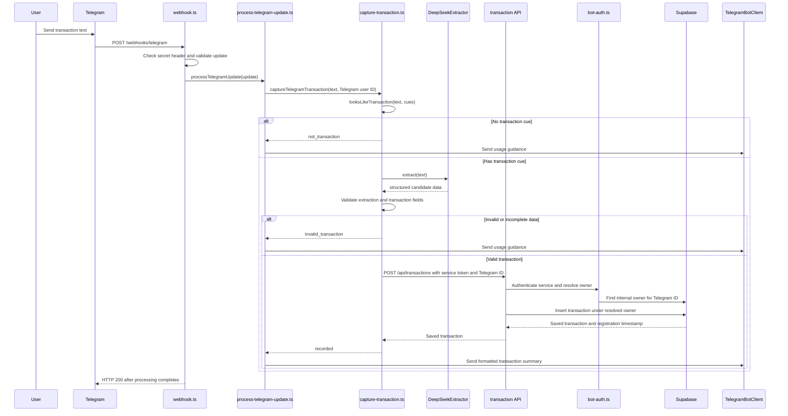
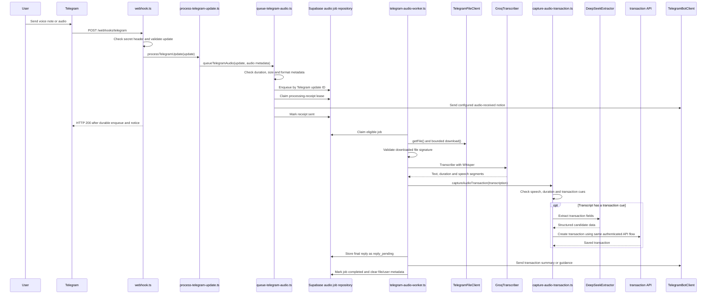

# How Telegram updates are processed

This guide follows a Telegram update through the backend. A **text update** is handled during the webhook request. An **audio update** is stored as a durable job and finished later by a background worker, so Telegram does not have to wait for transcription.

## Main components

| File | Role in the flow |
| --- | --- |
| `src/server.ts` | Loads configuration, creates adapters, connects dependencies, starts the Express server and audio worker. |
| `src/app.ts` | Mounts the Telegram webhook at `/webhooks/telegram` and the transaction API at `/api/transactions`. |
| `src/presentation/telegram/webhook.ts` | Authenticates and validates incoming Telegram updates, logs receipt, runs update processing, and acknowledges or rejects the webhook request. |
| `src/presentation/telegram/update.ts` | Defines the Zod schema for the Telegram update fields used by this app. |
| `src/service/process-telegram-update.ts` | Chooses the text or audio path and sends immediate replies for text updates. |
| `src/service/capture-transaction.ts` | Checks transaction cues, extracts and validates transaction data, then asks the API to persist it. |
| `src/presentation/http/transaction-router.ts` | Applies service authentication, Telegram owner resolution and owner-context validation to every transaction API route. |
| `src/service/telegram-audio-worker.ts` | Claims audio jobs, runs transcription and transaction capture, retries recoverable failures and delivers queued replies. |

## Text message flow

For example, the user sends `Gasté 120000 en Netflix`.

### What happens in code

1. `createTelegramWebhookRouter()` in `src/presentation/telegram/webhook.ts` handles `POST /webhooks/telegram`. The handler compares Telegram's `X-Telegram-Bot-Api-Secret-Token` header to the configured secret using a timing-safe comparison. It then parses the request body with `telegramUpdateSchema`.
2. The handler calls `processTelegramUpdate()` from `src/service/process-telegram-update.ts`. If the update has text and a Telegram sender ID, it calls `captureTelegramTransaction()` with the message, sender ID, and Telegram `update_id`.
3. `looksLikeTransaction()` in `src/service/transaction-cues.ts` checks the message for configured cues such as expense or income verbs. If none match, the system skips the language model and returns the configured usage guidance.
4. If a cue matches, `DeepSeekExtractor.extract()` in `src/infrastructure/deepseek/extractor.ts` sends the text and configured extraction prompt to DeepSeek. `captureTelegramTransaction()` validates the model result with `transactionExtractionSchema`, then validates the transaction fields with `createTransactionSchema`. Invalid or incomplete data returns usage guidance without calling the transaction API.
5. For valid data, the `TelegramTransactionApiClient.create()` method in `src/infrastructure/telegram/transaction-api-client.ts` sends an HTTP request to the configured `BOT_API_BASE_URL`. It includes the service credential, the Telegram sender ID, and the update ID as an idempotency key. The transaction fields come from the validated extraction.
6. The transaction API middleware in `src/presentation/http/bot-auth.ts` checks the service credential and resolves `X-Telegram-User-Id` to an internal owner ID. A Telegram ID without a user association is rejected. The owner ID is placed in the request context; the request body cannot choose it.
7. `createTransactionController()` in `src/presentation/http/transaction-controller.ts` calls `createTransaction()` from `src/service/transactions.ts`. The Supabase repository inserts the transaction with the resolved `owner_id`. The database supplies the registration timestamp. The repository also handles replayed update IDs without creating another transaction.
8. Once the API returns the saved transaction, `formatTransactionReply()` in `src/service/transaction-reply.ts` formats the amount and description using the configured locale, currency, and messages. `TelegramBotClient.sendMessage()` sends the reply. The webhook returns HTTP 200 after this processing and reply attempt completes.

## Audio message flow

Voice notes (`message.voice`) and audio messages (`message.audio`) use the same transaction capture logic after transcription. Generic Telegram documents are not treated as audio.

### What happens in code

1. `processTelegramUpdate()` detects `voice` or `audio` and calls `queueTelegramAudio()` in `src/service/queue-telegram-audio.ts`.
2. The queue service validates required Telegram audio metadata. It rejects malformed audio, duration above `AUDIO_MAX_DURATION_SECONDS`, oversized metadata, unsupported formats, and audio with unknown size. It calls `TelegramFileClient.getFile()` when Telegram metadata is needed to establish size or file format.
3. `SupabaseTelegramAudioJobRepository.enqueue()` stores the job keyed by Telegram `update_id`. Duplicate webhook deliveries do not create a second job. Before sending the configured processing notice, `claimReceipt()` obtains a database lease; `markReceiptSent()` then allows the worker's database claim function to process that job. The webhook is acknowledged only after enqueueing and sending that notice succeed.
4. `startTelegramAudioWorker()` in `src/service/telegram-audio-worker.ts` runs an asynchronous loop in the backend process. It asks the repository to claim an eligible job with a lease, so a job can be recovered if the process stops while handling it. This is asynchronous I/O work, not a separate operating-system thread.
5. `TelegramFileClient.getFile()` obtains Telegram's file path and `download()` streams the file with a hard byte limit and safe-path checks. `validateAudioMetadata()` checks the configured duration, size, and format limits; `audioMatchesFormat()` verifies the downloaded bytes' signature before the file is sent to a transcription provider.
6. `GroqTranscriber.transcribe()` in `src/infrastructure/groq/transcriber.ts` requests verbose Whisper output, including duration and speech segments. `captureAudioTransaction()` rejects empty or speech-free results and transcriptions longer than the configured limit. It then calls the same `captureTelegramTransaction()` used by text, including the cue check and DeepSeek extraction.
7. A successful capture produces the same API create request and ownership checks described above. If the transcript has no transaction cue, DeepSeek is skipped. If transcription is unusable, the worker selects configured guidance instead of creating a transaction.
8. Before delivering a final message, the worker saves it as `reply_pending` in Supabase. If Telegram delivery fails, it retries the reply without transcribing or creating the transaction again. On success, `complete()` marks the job complete and clears audio file, Telegram user, chat, and outbound message metadata. Expired deduplication rows are periodically removed.

## Failure and retry behavior

| Situation | Result |
| --- | --- |
| Webhook secret is missing or invalid, or the update payload is malformed | The webhook rejects the request; update processing does not run. |
| Text is ordinary conversation without a configured transaction cue | DeepSeek is not called; the bot replies with usage guidance. |
| DeepSeek returns incomplete or invalid transaction data | The transaction API is not called; the bot replies with usage guidance. |
| Telegram user has no internal user association | Owner resolution fails and no transaction is created; the bot replies that the account is not enabled. |
| Audio is malformed, too long, too large, unsupported, or has an invalid content signature | The job is rejected or receives validation guidance; invalid audio is not sent to Groq. |
| Audio contains no usable speech or no transaction cue | No transaction is created; the bot sends configured guidance. |
| Groq, Telegram file download, transaction API, or persistence has a temporary failure | The audio job is retried up to `AUDIO_MAX_ATTEMPTS`; after exhaustion, the user receives a temporary failure message when delivery is available. |
| Telegram cannot accept the final audio reply | The stored `reply_pending` message is retried without repeating transcription or transaction capture. |
| Text transaction API request is retried for the same Telegram update | The idempotency key prevents a duplicate transaction for that update. |

## Reading logs

`JsonLogger` in `src/infrastructure/logging/json-logger.ts` emits structured JSON events. Typical event families include `telegram.webhook.*`, `telegram.update.*`, `transaction.cue_check.*`, `llm.*`, `audio.job.*`, `audio.transcription.*`, `transaction_api.request.*`, and `supabase.transaction.*`. Logs are intended to show lifecycle outcomes, durations, retry counts, and error categories. They must not contain Telegram user/chat IDs, credentials, file references, audio, transcripts, prompts, or financial transaction values.

## Where to start reading

For a text update, start with `src/presentation/telegram/webhook.ts`, then follow `src/service/process-telegram-update.ts` → `src/service/capture-transaction.ts` → `src/infrastructure/deepseek/extractor.ts` → `src/infrastructure/telegram/transaction-api-client.ts`.

For audio, start at the same webhook and update processor, then follow `src/service/queue-telegram-audio.ts` for intake and `src/service/telegram-audio-worker.ts` for background processing. Continue through `src/infrastructure/telegram/file-client.ts`, `src/infrastructure/groq/transcriber.ts`, and `src/service/capture-audio-transaction.ts`; from there, successful audio follows the shared transaction capture and API path.
